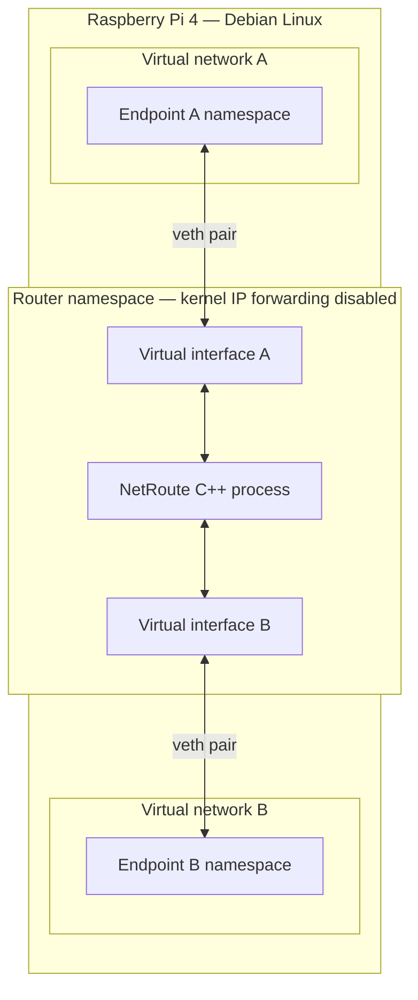

# NetRoute

**C++ Software Router & Telemetry Engine**

A personal portfolio project exploring C++ systems programming, Linux networking, and embedded Linux development. NetRoute will grow from an offline packet analyzer into an IPv4 software router with multithreaded processing and telemetry.

## Status

Planning and documentation only. No executable or implemented features yet. The next milestone is a minimal C++20 CMake project; setup and usage instructions will follow once the build is verified.

## Roadmap

1. **Development setup:** C++20, CMake, a Debug build, and debugger support.
2. **Packet analysis:** Read captures with libpcap and implement Ethernet, IPv4, TCP, and UDP parsing, initially for unfragmented IPv4 traffic.
3. **Routing:** Longest-prefix matching and IPv4 forwarding in an isolated Linux network namespace lab.
4. **Multithreading:** Bounded queues, explicit packet ownership, and graceful shutdown.
5. **Telemetry:** Protocol counts, forwarding/drop statistics, queue depth, throughput, and processing latency.
6. **Automation:** Integration tests, CI, repeatable benchmarks, and Pi deployment documentation.

## Target platform

Raspberry Pi 4 Model B (8 GB), running Debian 13 on ARM64. Development is planned through VS Code Remote SSH, using C++20, CMake, and libpcap.

## Planned deployment

The lab will run entirely on the Raspberry Pi. Two virtual networks will each contain one virtual endpoint, connected through a dedicated router namespace running NetRoute.

NetRoute will forward IPv4 packets between the networks. Linux kernel IP forwarding will be disabled in the router namespace so it cannot bypass NetRoute. The lab will verify that the endpoints communicate while NetRoute runs and lose connectivity when it stops. The Pi's SSH management connection will remain outside the lab namespaces.
